# Funcionamento do EV ChargeOps

Este documento mostra, com capturas de tela, o fluxo de uso do protótipo: cadastros base, registro de sessões, gerador de dados, cálculo do rateio, emissão de faturas e consulta pelo chat assistente. Todos os dados são fictícios, criados apenas para teste.

Ordem do fluxo: **Unidades → Usuários → Carregadores → Tarifas → Sessões → Gerador de dados → Rateio e faturas → Chat**.

## 1. Unidades

Cadastro dos apartamentos ou espaços físicos que podem ser associados aos usuários.

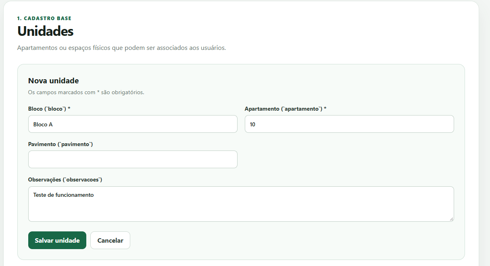

Após salvar, a listagem é atualizada e exibe a nova unidade.

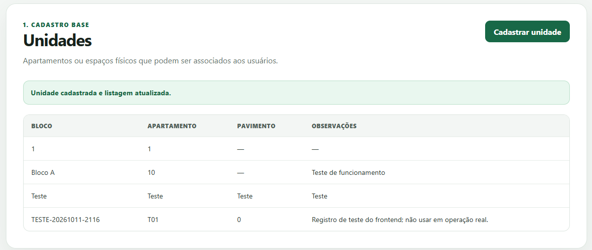

## 2. Usuários

Cada usuário pode ser vinculado a uma unidade já cadastrada. Senha e RFID não são coletados nesta interface.

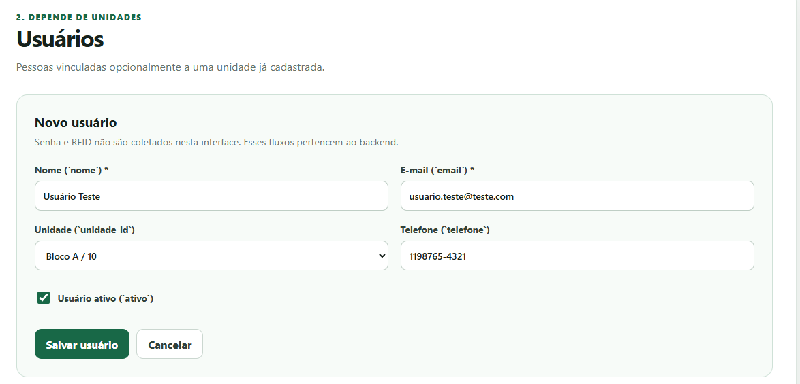

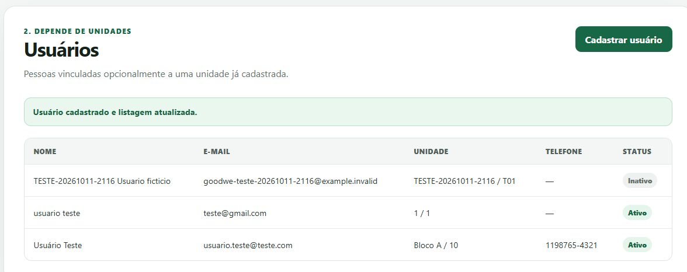

## 3. Carregadores

Cadastro dos equipamentos da infraestrutura, com modelo, número de série, localização, potência máxima e status.

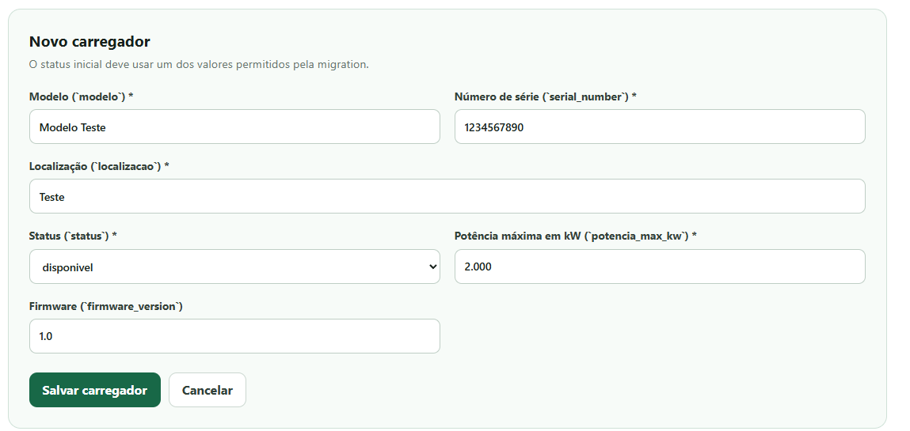

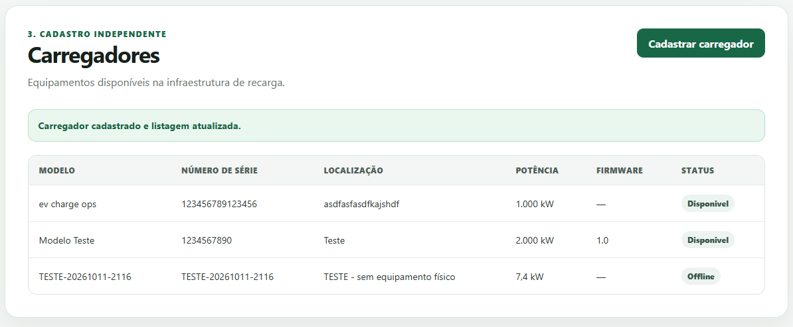

## 4. Tarifas

Valor do kWh com período de vigência. A tarifa selecionada é usada no cálculo do rateio.

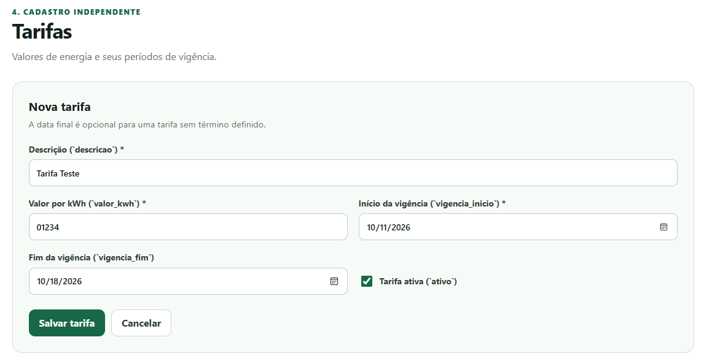

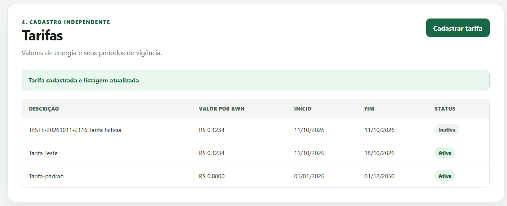

## 5. Sessões de recarga

Cada sessão liga um usuário a um carregador e registra início, fim, energia entregue (kWh) e status. Somente sessões finalizadas ou interrompidas entram no rateio.

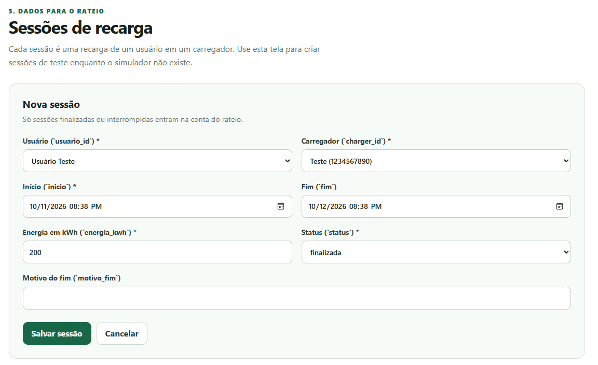

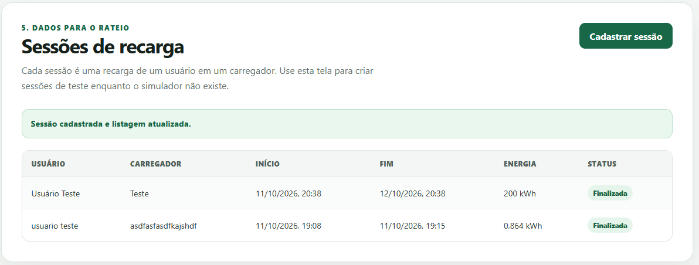

## 6. Gerador de dados (simulador)

Como não há acesso ao carregador físico, a tela "Gerador de dados" simula o equipamento e alimenta a tabela `sessoes`.

**Gerador de sessões:** cria um histórico de sessões a partir de parâmetros como dias de histórico, sessões por dia, potência, tarifa e usuários incluídos. Uma semente opcional permite repetir exatamente a mesma prévia. No exemplo, 30 dias com 1 a 2 sessões por dia geraram 45 sessões, 3.600 kWh e R$ 3.312,00 (45 sessões × 80 kWh × R$ 0,92).

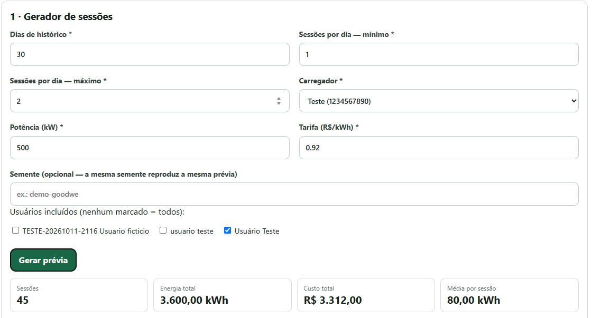

**Simulação ao vivo:** reproduz uma recarga em tempo real, com tempo de sessão, energia, custo e potência instantânea. A velocidade do tempo é ajustável (na captura, 1 minuto por segundo). Ao encerrar, a sessão é salva na tabela `sessoes`.

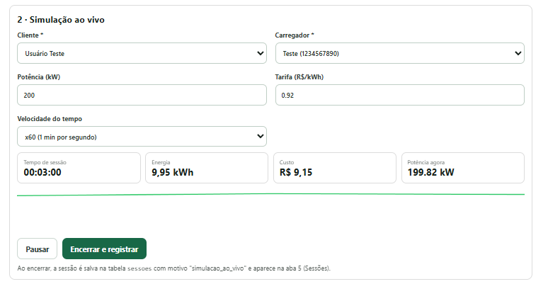

**Prévia de rateio e histórico:** mostra a divisão do consumo por usuário e as sessões mais recentes, indicando se a origem é o banco ou o gerador.

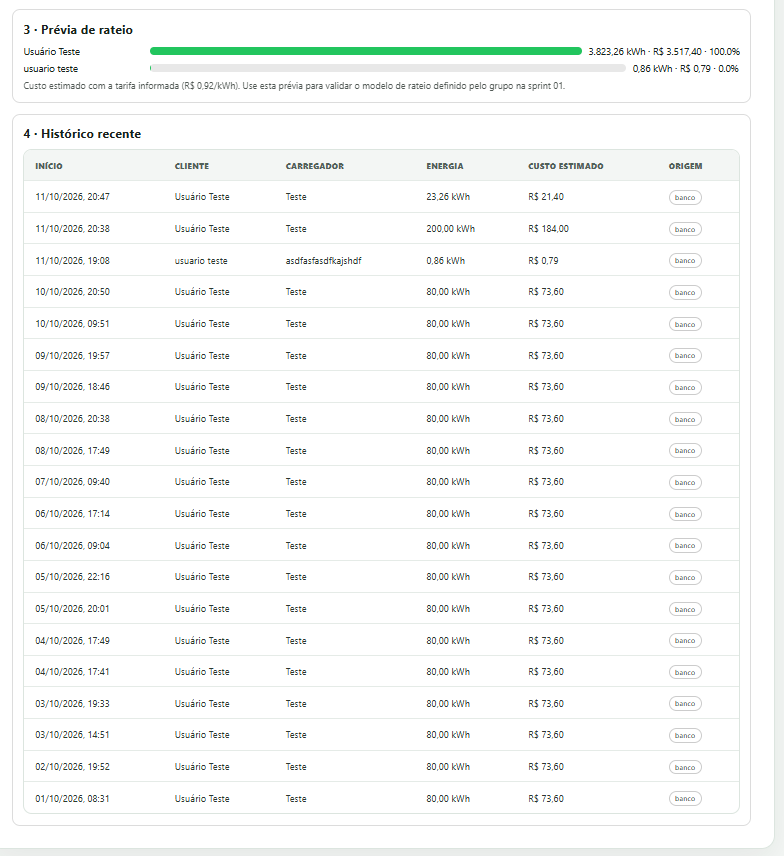

## 7. Rateio e faturas

O motor de rateio soma as sessões do mês de cada usuário e calcula:

`valor final = (energia em kWh × tarifa do kWh) + taxa administrativa`

Primeiro o gestor escolhe o mês, a tarifa e a taxa (fixa em R$ e percentual).

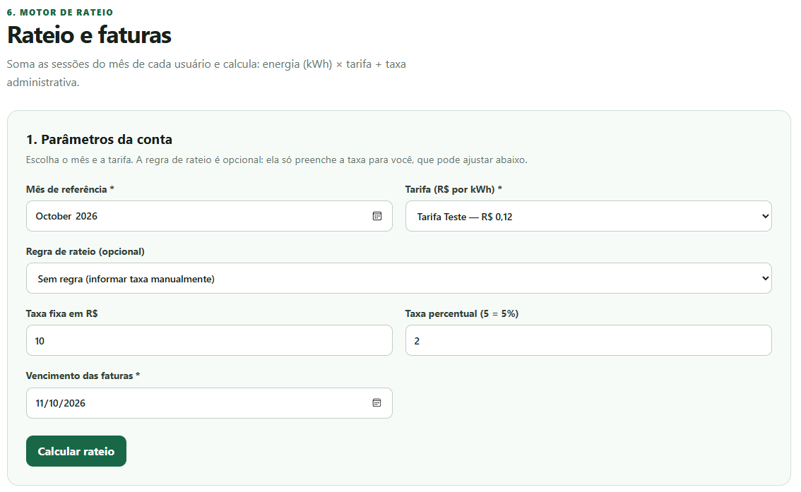

A prévia mostra o resultado antes de salvar. Exemplo conferido: 200 kWh × R$ 0,1234 = R$ 24,68; taxa de R$ 10,00 + 2% de R$ 24,68 = R$ 10,49; total de R$ 35,17.

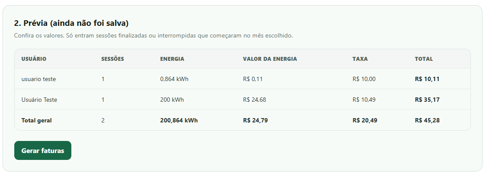

Ao gerar as faturas, elas ficam registradas com vencimento e status "Pendente".

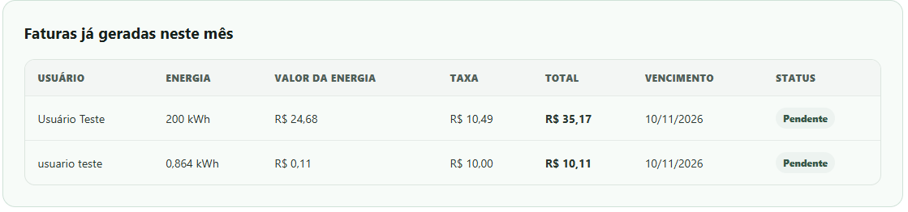

## 8. Chat assistente (IA)

O assistente consulta os dados do banco e responde em linguagem natural. Na captura, a pergunta sobre o consumo por mês retorna 200,864 kWh em 2 sessões, valor que coincide com a soma das sessões da etapa 5, e a resposta informa a fonte consultada.

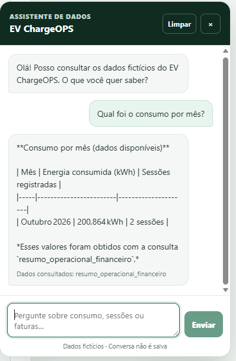
